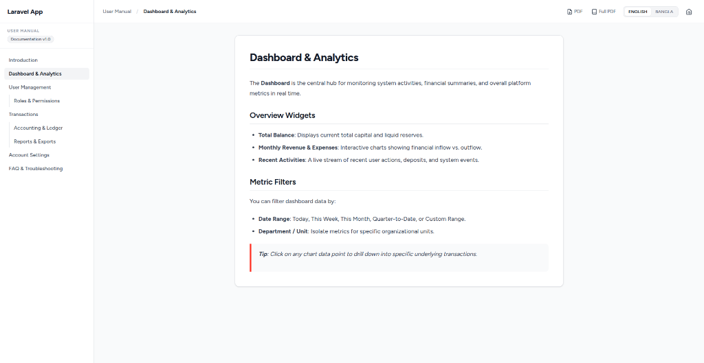

# Laravel User Manual

A markdown-based in-app user manual and help center for Laravel applications with multi-locale support, permission-aware navigation, and dynamic PDF exports.

[](https://packagist.org/packages/muhammadmahedihasan/laravel-user-manual)
[](https://github.com/muhammadmahedihasan/laravel-user-manual/actions)
[](https://packagist.org/packages/muhammadmahedihasan/laravel-user-manual)
[](LICENSE)



## Contents

- [Why?](#why)
- [Features](#features)
- [Quick Start](#quick-start)
- [Installation](#installation)
- [Content Structure](#content-structure)
- [Configuration](#configuration)
- [PDF Export](#pdf-export)
- [Permissions](#permissions)
- [AI Authoring](#ai-authoring)
- [Why Laravel User Manual?](#why-laravel-user-manual)
- [Commands](#commands)
- [Upgrading to 2.0](#upgrading-to-20)
- [Development](#development)
- [Contributing](#contributing)
- [Security](#security)
- [Changelog](#changelog)
- [License](#license)

---

## Why?

SaaS applications, ERP systems, and internal admin tools frequently require an integrated user manual, help center, or knowledge base. Building a custom documentation engine often leads to unmaintained Blade views, hardcoded links, iframe widgets, or unmanaged access permissions for confidential guides.

Laravel User Manual solves this by turning plain Markdown files into a secure, responsive in-app documentation portal. Because your documentation lives directly inside your repository, it stays version-controlled, testable, and synchronized with your application code—without external SaaS subscriptions, database tables, or third-party widgets.

### Use this package when you need to:
- Store version-controlled Markdown documentation directly inside your application repository.
- Serve localized, multi-language user guides and admin documentation.
- Restrict sensitive documentation pages to specific roles or permissions using your existing authorization logic.
- Export styled, branded PDF user manuals for offline distribution.
- Deliver a fast, in-app knowledge base without database tables or external service dependencies.

---

## Features

### Documentation & Content
- **Markdown-First**: Write documentation using standard GitHub-Flavored Markdown (GFM).
- **Dynamic Navigation**: Build clean multi-level sidebar navigation from a simple `navigation.md` file.
- **Version Management**: Organize documentation sets by product release versions (e.g., `1.0`, `2.0`).

### Localization & Multi-Language
- **Multi-Locale Routing**: Serve language-specific documentation out of the box (e.g., `/user-manual/en/...`, `/user-manual/bn/...`).
- **Locale-Aware Formatting**: Automatically format page numbers, TOC indexes, and dates using localized numeral scripts (such as Bengali digits via PHP `intl`).

### Security & Access Control
- **Permission Mapping**: Control access to individual pages or sub-sections via Laravel permissions or roles.
- **Super Admin Bypass**: Assign roles that automatically bypass documentation restrictions.
- **Custom Access Resolvers**: Extend authorization logic using a closure-based facade callback.
- **Any Role System**: Works with a `role` column, an enum, your own roles table, spatie/laravel-permission, Bouncer, or no roles at all. No role package required.
- **Safe CommonMark Defaults**: Protect your app against stored XSS by automatically escaping raw HTML and blocking unsafe `javascript:` links by default.

### Performance & Caching
- **Automatic Cache Invalidation**: Cache rendered Markdown and navigation trees using file modification timestamps (`filemtime`), invalidating instantly when `.md` files are edited.
- **Zero Database Load**: Deliver cached documentation pages with sub-5ms response times; full PDFs are streamed from storage, never rendered on request.

### PDF Export
- **Single Page & Full Manual**: Download one page (rendered instantly) or the whole manual (pre-generated per role, streamed from storage).
- **Role-Aware Full Manual**: One full PDF per role, regenerated in the background when a role changes. Plug in any role system.
- **Branded Layouts**: Customize cover pages, tables of contents, headers, and footers using Blade templates.
- **Custom Typography**: Support custom TrueType fonts for non-Latin character sets via mPDF integration.

---

## Quick Start

Get up and running with your first documentation page in a few simple steps:

1. **Install the package**:
   ```bash
   composer require muhammadmahedihasan/laravel-user-manual
   ```

2. **Publish assets and configuration**:
   ```bash
   php artisan vendor:publish --tag=user-manual
   ```
   *(Demo documentation stubs for `navigation.md` and `introduction.md` are automatically generated on first boot).*

3. **Configure navigation (`resources/user-manual/1.0/en/navigation.md`)**:
   ```markdown
   - [Introduction](/user-manual/en/introduction)
   ```

4. **Write documentation (`resources/user-manual/1.0/en/introduction.md`)**:
   ```markdown
   # Introduction

   Welcome to the application user manual.
   ```

5. **View in browser**:
   Navigate to `/user-manual` in your browser.

6. **(Optional) Pre-generate the full manual PDF**:
   ```bash
   php artisan user-manual:pdf
   ```
   Single page PDFs work right away. The "Full PDF" button serves files made by this command (see [Full Manual PDFs per Role](#full-manual-pdfs-per-role)).

---

## Installation

### System Requirements
- **PHP**: `^8.2` (Laravel 13 requires PHP `^8.3`)
- **Laravel Framework**: `^10.0`, `^11.0`, `^12.0`, or `^13.0`
- **Extensions**: `ext-intl`

### Install Package
```bash
composer require muhammadmahedihasan/laravel-user-manual
```

### Publish Package Resources
Publish configuration files, Blade views, language translations, assets, and documentation stubs:

```bash
php artisan vendor:publish --tag=user-manual
```

To publish components selectively:

```bash
php artisan vendor:publish --tag=user-manual-config
php artisan vendor:publish --tag=user-manual-views
php artisan vendor:publish --tag=user-manual-lang
php artisan vendor:publish --tag=user-manual-assets
php artisan vendor:publish --tag=user-manual-docs
```

---

## Content Structure

Documentation files are organized inside `resources/user-manual/{version}/{locale}/`:

```
resources/user-manual/
└── 1.0/
    ├── en/
    │   ├── navigation.md
    │   ├── introduction.md
    │   └── user-management.md
    └── bn/
        ├── navigation.md
        ├── introduction.md
        └── user-management.md
```

### Title Extraction
The renderer automatically extracts the first `# H1` header in the Markdown file for page titles and browser header tags. If no `# H1` header is found, it formats the filename slug into words.

### Navigation Hierarchy
Sidebar navigation is driven by `navigation.md` in each locale directory. Indent items by two spaces to create nested sub-sections:

```markdown
- [Introduction](/user-manual/en/introduction)
- [User Management](/user-manual/en/user-management)
  - [Roles & Permissions](/user-manual/en/roles-and-permissions)
- [External Help](https://example.com/support)
```

---

## Configuration

Publishing `config/user-manual.php` provides control over routing, security, caching, and layout options:

```php
return [
    'route_prefix' => 'user-manual',
    'route_name' => 'user-manual.show',
    'middleware' => ['web', 'auth'],
    'version' => '1.0',
    'content_path' => resource_path('user-manual'),
    'default_page' => 'introduction',
    'locales' => ['en'],
    'default_locale' => 'en',
    'cache_ttl' => 3600,
    'cache_prefix' => 'user-manual',
    // Merged over safe defaults (html_input: escape, allow_unsafe_links: false).
    // Override only if you trust all markdown authors.
    'commonmark' => [],

    // Access control (see Permissions)
    'access_checker' => \MuhammadMahediHasan\UserManual\Access\DefaultAccessChecker::class,
    'super_admin_roles' => [],
    'permission-mapper' => [],

    // Roles: one full manual PDF is pre-generated per role (see PDF Export)
    'roles' => [
        'resolver' => \MuhammadMahediHasan\UserManual\Roles\DefaultRoleResolver::class,
        'list' => [],
        'model' => null,
        'name' => 'name',
        'permissions' => 'permissions',
        'permission_name' => 'name',
        'scope' => null,
        'user_roles' => 'roles',
    ],

    'pdf' => [
        'enabled' => true,
        'page' => ['enabled' => true],
        'full' => ['enabled' => true, 'pending_view' => 'user-manual::pdf.pending', 'retry_after' => 60],
        'disk' => 'local',
        'directory' => 'user-manual/pdfs',
        'queue' => ['connection' => null, 'queue' => null, 'timeout' => 600, 'tries' => 1, 'unique_for' => null],
        // paper format, margins, fonts, cover/header/footer views…
    ],
];
```

### Multiple manuals

Leave `manuals` empty for a single manual. That keeps the root `content_path`, `route_prefix`, locales, and route names (`user-manual.show`, `user-manual.pdf.page`, `user-manual.pdf.full`).

Set `manuals` when one application serves more than one manual. Each entry inherits the root config and overrides only the keys it sets. A manual is a content tree plus a route. Locales stay folders inside that tree (`{content_path}/{version}/{locale}/{page}.md`), so each panel can have its own `en` and `bn` pages.

The package does not require a domain. An application that splits panels by path uses a different `route_prefix` for each manual:

```php
'manuals' => [
    'staff' => [
        'content_path' => resource_path('user-manual/staff'),
        'route_prefix' => 'manual',
        'locales' => ['en', 'bn'],
        'middleware' => ['web', 'auth'],
    ],
    'partner' => [
        'content_path' => resource_path('user-manual/partner'),
        'route_prefix' => 'partner/manual',
        'locales' => ['en', 'bn'],
        'middleware' => ['web', 'auth:partner'],
        'auth_guards' => ['partner'],
    ],
],
```

An application that serves the same path on two hosts passes Laravel route-group attributes through `route`. `domain` is only one of those attributes. `prefix`, `where`, or `middleware` work the same way. If both `middleware` and `route.middleware` are set, the route-group list is registered.

```php
'manuals' => [
    'portal' => [
        'content_path' => resource_path('user-manual/portal'),
        'route_prefix' => 'user-manual',
        'locales' => ['en', 'bn'],
        'route' => [
            'domain' => env('PORTAL_DOMAIN', 'abc.com'),
            'middleware' => ['web', 'auth'],
        ],
    ],
    'admin' => [
        'content_path' => resource_path('user-manual/admin'),
        'route_prefix' => 'user-manual',
        'locales' => ['en', 'bn'],
        'route_name' => 'admin.user-manual.show',
        'cache_prefix' => 'user-manual.admin',
        'route' => [
            'domain' => env('ADMIN_DOMAIN', 'x.abc.com'),
            'middleware' => ['web', 'auth:admin'],
        ],
        'auth_guards' => ['admin'],
    ],
],
```

Named manuals that omit `route_name` use `{name}.user-manual.show`. PDF routes follow the same pattern (`{name}.user-manual.pdf.page` and `{name}.user-manual.pdf.full`). A named manual that omits `cache_prefix` suffixes the root prefix with its name so cached pages and PDFs do not collide. `user-manual:cache` and `user-manual:clear-cache` accept an optional manual name and otherwise run for every manual.

`navigation.md` links use that manual's own public prefix. Set `set_locale_on_visit` on a manual when visiting it should not write the shared locale session key.

### CommonMark options

Markdown is rendered with League CommonMark (GitHub-flavored). Package defaults escape raw HTML and block unsafe links. Values under `commonmark` are merged on top of those defaults and passed to `GithubFlavoredMarkdownConverter`:

```php
'commonmark' => [
    'html_input' => 'allow',
    'allow_unsafe_links' => true,
],
```

Only do this if you trust every markdown author; allowing raw HTML increases stored XSS risk because rendered content is output unescaped in the manual view.

### Customizing UI & Host Application Styles
The package publishes pre-scoped assets (`user-manual.css` and `user-manual.js`) to `public/vendor/user-manual/`. To layer host application styles (such as Tailwind CSS entrypoints) on top of the manual layout, configure `ui.vite_assets`:

```php
'ui' => [
    'logo_url' => '/images/logo.svg',
    'home_url' => '/',
    'back_url' => '/dashboard',
    'vite_assets' => ['resources/css/app.css'],
    'primary_color' => '#FF2D20',
],
```

---

## PDF Export

Laravel User Manual provides single-page and full manual PDF exports using mPDF.

### Export Routes
- **Single Page PDF**: `/user-manual/{locale}/{page}/pdf` (`user-manual.pdf.page`): rendered on request, nothing stored.
- **Full Manual PDF**: `/user-manual/{locale}/export/pdf` (`user-manual.pdf.full`): the pre-generated PDF of the viewer's role.

### PDF Features
- **Structured Indexing**: Automatically compiles all accessible documentation pages into a single PDF document with a table of contents.
- **Locale-Aware Numerals**: Adapts pagination (e.g. `1/10` vs `১/১০`) to the active locale.
- **Memory Efficiency**: Chunks large HTML streams during document assembly.

### Custom Fonts & Typography
To support custom fonts (e.g. non-Latin scripts), define font paths under `pdf.fonts` in `config/user-manual.php`:

```php
'pdf' => [
    'default_font' => 'kalpurush',
    'fonts' => [
        'font_dirs' => [resource_path('fonts')],
        'font_data' => [
            'kalpurush' => [
                'R' => 'kalpurush.ttf',
                'B' => 'kalpurush.ttf',
                'useOTL' => 0xFF,
                'useKashida' => 75,
            ],
        ],
    ],
],
```

### Customizing Covers, Headers & Footers
Publish views (`php artisan vendor:publish --tag=user-manual-views`) to customize PDF templates in `resources/views/vendor/user-manual/pdf/`:
- `cover.blade.php`: Cover page header, subtitle, logo, and generation date.
- `header.blade.php`: Document running headers.
- `footer.blade.php`: Document running footers and page numbers.

### Full Manual PDFs per Role

Rendering a whole manual takes long, so the full PDF is **never rendered during a web request**. It is generated ahead of time, once per role, and stored on a filesystem disk. A download only looks up the viewer's role and streams that file.

```
user-manual:pdf / queued job  ──►  disk: user-manual/pdfs/{manual}/{version}/{locale}/
                                       manifest.json            role key → file
                                       {signature}-{hash}.pdf   one per page set
download ──► role of user ──► manifest ──► stream file
```

- Roles that can read the same pages share one file.
- When content or a role changes, a new file is written first; the role is switched to it, then the old file is deleted if no other role uses it. Users never hit a missing file.
- If a role has no PDF yet, the first download queues a job (only once: the job is unique per manual, locale and role) and answers **202** with a "your PDF is being prepared" page, or JSON `{"status": "generating"}` for `Accept: application/json`.
- If the markdown changed since the PDF was generated, the old PDF is still served while a fresh one is queued. Only `.md` files are watched: after changing **only images**, run `php artisan user-manual:pdf --force`.

#### 1. Tell the package about your roles

The package needs no role package. Pick the resolver that matches how your app stores roles, in the `roles` block of `config/user-manual.php`:

| Your app | Resolver | Config |
| --- | --- | --- |
| No roles | `Roles\DefaultRoleResolver` (default) | nothing: everyone gets one `default` PDF |
| Roles in code: a `users.role` column or an enum | `Roles\ConfigRoleResolver` | `list` (role → profile), `user_roles` |
| Roles in a database table (your own table, spatie/laravel-permission, Bouncer, …) | `Roles\EloquentRoleResolver` | `model`, `name`, `permissions`, `permission_name`, `scope`, `user_roles` |
| Anything else | your own `Contracts\RoleResolver` class, or closures | |

An access profile is what a role may see, in the same terms as `permission-mapper`:

| Profile | Meaning |
| --- | --- |
| `[]` | signed-in user without permissions |
| `['perm_a', 'perm_b']` | has these permissions |
| `['perm_a', 'roles' => ['Editor']]` | permissions plus role names |
| `'all'` | every page |

**Roles in code**

```php
'roles' => [
    'resolver' => \MuhammadMahediHasan\UserManual\Roles\ConfigRoleResolver::class,
    'user_roles' => 'role',          // users.role: "admin", "editor", … (string or enum)
    'list' => [
        'admin' => 'all',
        'editor' => ['post_edit', 'post_publish'],
        'member' => [],
    ],
],
```

**Roles in a table**

```php
'roles' => [
    'resolver' => \MuhammadMahediHasan\UserManual\Roles\EloquentRoleResolver::class,
    'model' => App\Models\Role::class,
    'name' => 'name',                 // role name attribute
    'permissions' => 'permissions',   // relation of permission models, an array/JSON column, or null
    'permission_name' => 'name',      // name attribute of permission models
    'scope' => null,                  // invokable class (Builder $query, ManualDefinition $manual), e.g. to filter a guard or tenant
    'user_roles' => 'roles',          // where a user's role(s) are: 'roles' (many), 'role' (belongsTo), 'role_id' (column)
],
```

With spatie/laravel-permission the defaults already fit: set `model` to your role model (and add a `scope` class with `where('guard_name', 'web')` if you use several guards). A users table with `role_id` and a JSON `abilities` column on roles works with `'permissions' => 'abilities', 'user_roles' => 'role'`.

Role keys are the model keys. For needs the config can't express, extend `EloquentRoleResolver` and override `query()`, `permissionsFor()` or `roleFor()`.

**Your own resolver**

```php
interface RoleResolver
{
    // role key => access profile, for every role
    public function roles(ManualDefinition $manual): iterable;

    // the user's role key (null = "default")
    public function roleFor(Authenticatable $user, ManualDefinition $manual): int|string|null;
}
```

Set it as `roles.resolver`, or register closures in a service provider:

```php
use MuhammadMahediHasan\UserManual\Facades\UserManual;

UserManual::resolveRolesUsing(
    roles: fn (ManualDefinition $manual) => ['admin' => 'all', 'staff' => ['reports_view']],
    roleFor: fn ($user, ManualDefinition $manual) => $user->is_admin ? 'admin' : 'staff',
);
```

`roles.*` (like every key) can be overridden per entry in `manuals`.

#### 2. Generate the PDFs

```bash
php artisan user-manual:pdf                      # every manual, locale and role (add to your deploy)
php artisan user-manual:pdf staff --locale=en    # one manual / locale
php artisan user-manual:pdf --role=3 --role=7    # some roles
php artisan user-manual:pdf --queue              # dispatch jobs instead of rendering here
php artisan user-manual:pdf --force              # render again even if up to date
php artisan user-manual:pdf --unlock --queue     # free locks left by killed jobs, then queue again
php artisan user-manual:pdf-clear                # delete all stored full PDFs
```

Without `--queue` the command renders in its own process (good for deploys) and removes files and manifest entries of roles that no longer exist.

#### 3. Keep them up to date when roles change

Call these wherever your app creates, updates or deletes roles (after the transaction commits):

```php
UserManual::regenerateRole($role->id);  // queue new PDFs; the old ones are served until they are ready
UserManual::forgetRole($role->id);      // role deleted: remove its PDFs
UserManual::releaseLocks($role->id);    // free "already queued" locks left by a killed job
```

Both accept an optional manual name as second argument.

#### Configuration

```php
'pdf' => [
    'page' => ['enabled' => true],
    'full' => [
        'enabled' => true,
        'pending_view' => 'user-manual::pdf.pending', // shown with HTTP 202
        'retry_after' => 60,                          // Retry-After header (seconds)
    ],
    'disk' => env('USER_MANUAL_PDF_DISK', 'local'),   // any filesystem disk, e.g. s3
    'directory' => 'user-manual/pdfs',
    'queue' => [
        'connection' => env('USER_MANUAL_PDF_QUEUE_CONNECTION'), // null = default
        'queue' => env('USER_MANUAL_PDF_QUEUE'),
        'timeout' => 600,
        'tries' => 1,
        'unique_for' => null, // how long a waiting job blocks duplicates; null = timeout + 60
        'job' => \MuhammadMahediHasan\UserManual\Jobs\GenerateFullManualPdf::class, // or a subclass
    ],
],
```

> **Queue:** use a real queue (`database`, `redis`, …) with a worker in production, and give the worker the job's timeout (`php artisan queue:work --timeout=600`; `queue:listen` defaults to 60 seconds, too short for big manuals). On the `sync` connection, jobs started from a web request (a download, `regenerateRole()` after saving a role) run **after the response is sent**, with the job timeout as time limit, so the request itself stays fast.

> **"Queued" but nothing in the `jobs` table?** Each job is unique per manual, locale and role. While one is waiting or running, dispatching it again does nothing. If a worker or request was killed mid-job, its lock stays until `unique_for` passes (default: timeout + 60 seconds). Release it right away with `php artisan user-manual:pdf --unlock` (`user-manual:pdf-clear` releases locks too). Also check that no worker such as `queue:listen` is already taking jobs off the table.

#### Events

- `Events\FullPdfGenerated` (`manual`, `locale`, `roleKey`, `path`, `reused`)
- `Events\FullPdfGenerationFailed` (`manual`, `locale`, `roleKey`, `exception`)

> **Note:** Large full-manual PDFs with images are memory-heavy. If generation fails with a memory error, raise `memory_limit` for the CLI / queue worker.

> **Tip: keep screenshots lean.** Every role's PDF embeds its own copy of each image, so image size multiplies. PNG screenshots with an unused transparency channel are especially slow and large in mPDF. Optimizing them typically makes PDFs about 3× smaller and much faster to build, with no visible change:
> ```bash
> mogrify -background white -alpha remove -alpha off public/path/to/images/*.png   # drop unused transparency (ImageMagick)
> pngquant --quality=85-98 --skip-if-larger --strip --ext .png --force public/path/to/images/*.png
> optipng -quiet -o2 -strip all public/path/to/images/*.png
> php artisan user-manual:pdf --force
> ```
> Only drop transparency from images that don't use it (`identify -format '%[opaque]'` prints `True` for those).

#### Examples

**A full setup with a roles table**

```php
// config/user-manual.php
'super_admin_roles' => ['Super Admin'],

'permission-mapper' => [
    'introduction' => '*',
    'reports' => ['report_view'],
    'billing' => ['billing_manage'],
    'system-settings' => ['roles' => ['Admin']],
],

'roles' => [
    'resolver' => \MuhammadMahediHasan\UserManual\Roles\EloquentRoleResolver::class,
    'model' => App\Models\Role::class,
    'user_roles' => 'roles',
],

'pdf' => [
    'disk' => 's3',
    'queue' => ['connection' => 'redis', 'queue' => 'pdf'],
],
```

```bash
php artisan user-manual:pdf          # on deploy
php artisan queue:work redis --queue=pdf --timeout=600
```

Each role gets a PDF with only the pages it may read. A role with `report_view` gets "Reports" but not "Billing", and Super Admins get everything.

**Filter roles with a scope class** (a guard, a tenant, active roles only):

```php
namespace App\UserManual;

use Illuminate\Database\Eloquent\Builder;
use MuhammadMahediHasan\UserManual\Support\ManualDefinition;

class WebRolesOnly
{
    public function __invoke(Builder $query, ManualDefinition $manual): void
    {
        $query->where('guard_name', 'web');
    }
}
```

```php
'roles' => [
    'resolver' => \MuhammadMahediHasan\UserManual\Roles\EloquentRoleResolver::class,
    'model' => App\Models\Role::class,
    'scope' => App\UserManual\WebRolesOnly::class,
],
```

**Extend `EloquentRoleResolver`** when a role's permissions depend on more than the config can say, e.g. permissions stored per tenant on the pivot, and one manual per tenant:

```php
namespace App\UserManual;

use App\Models\Role;
use Illuminate\Database\Eloquent\Builder;
use MuhammadMahediHasan\UserManual\Roles\EloquentRoleResolver;
use MuhammadMahediHasan\UserManual\Support\ManualDefinition;

class TenantRoleResolver extends EloquentRoleResolver
{
    protected function query(ManualDefinition $manual): Builder
    {
        // `tenant` is a custom key on the manual entry in config/user-manual.php
        $tenant = $manual->resolve('tenant', 'default');

        return Role::query()->with([
            'permissions' => fn ($query) => $query->wherePivot('tenant', $tenant),
        ]);
    }
}
```

```php
'roles' => ['resolver' => App\UserManual\TenantRoleResolver::class, 'model' => App\Models\Role::class],

'manuals' => [
    'shop' => ['content_path' => resource_path('user-manual/shop'), 'route_prefix' => 'shop/help', 'tenant' => 'shop'],
    'crm' => ['content_path' => resource_path('user-manual/crm'), 'route_prefix' => 'crm/help', 'tenant' => 'crm'],
],
```

**Write your own resolver**, e.g. for roles from an external API or a hard-coded enum:

```php
namespace App\UserManual;

use App\Enums\Role;
use Illuminate\Contracts\Auth\Authenticatable;
use MuhammadMahediHasan\UserManual\Contracts\RoleResolver;
use MuhammadMahediHasan\UserManual\Support\ManualDefinition;

class EnumRoleResolver implements RoleResolver
{
    public function roles(ManualDefinition $manual): iterable
    {
        foreach (Role::cases() as $role) {
            yield $role->value => $role === Role::Owner ? 'all' : $role->permissions();
        }
    }

    public function roleFor(Authenticatable $user, ManualDefinition $manual): ?string
    {
        return $user->role?->value; // null → "default"
    }
}
```

If you add your own `default` role, list it in `roles()` too. Any key `roleFor()` returns must exist there.

**Regenerate PDFs when roles change**, from an observer:

```php
namespace App\Observers;

use App\Models\Role;
use MuhammadMahediHasan\UserManual\Facades\UserManual;

class RoleObserver
{
    public bool $afterCommit = true;

    public function saved(Role $role): void
    {
        UserManual::regenerateRole($role->getKey());
    }

    public function deleted(Role $role): void
    {
        UserManual::forgetRole($role->getKey());
    }
}
```

Model events don't fire when only a pivot changes (e.g. `$role->permissions()->sync(...)`). In that case call `UserManual::regenerateRole()` right after the sync, or wrap it with `DB::afterCommit(fn () => UserManual::regenerateRole($role->id))` inside a transaction. You can also refresh one manual only: `UserManual::regenerateRole($role->id, 'crm')`.

**React to generation results**:

```php
use Illuminate\Support\Facades\Event;
use Illuminate\Support\Facades\Log;
use MuhammadMahediHasan\UserManual\Events\FullPdfGenerated;
use MuhammadMahediHasan\UserManual\Events\FullPdfGenerationFailed;

Event::listen(fn (FullPdfGenerated $event) => Log::info("Manual PDF ready: {$event->manual}/{$event->locale} for role {$event->roleKey}"));

Event::listen(fn (FullPdfGenerationFailed $event) => Log::error('Manual PDF failed', [
    'manual' => $event->manual,
    'role' => $event->roleKey,
    'error' => $event->exception?->getMessage(),
]));
```

**Customize the job** (middleware, backoff, more memory):

```php
namespace App\Jobs;

use Illuminate\Queue\Middleware\WithoutOverlapping;
use MuhammadMahediHasan\UserManual\Jobs\GenerateFullManualPdf;
use MuhammadMahediHasan\UserManual\Pdf\FullPdfGenerator;

class GenerateManualPdf extends GenerateFullManualPdf
{
    public function middleware(): array
    {
        return [(new WithoutOverlapping('user-manual-pdf'))->releaseAfter(30)];
    }

    public function handle(FullPdfGenerator $generator): void
    {
        ini_set('memory_limit', '1G');

        parent::handle($generator);
    }
}
```

```php
'pdf' => ['queue' => ['job' => App\Jobs\GenerateManualPdf::class]],
```

**Custom "being prepared" page**: copy `resources/views/vendor/user-manual/pdf/pending.blade.php` (published with `--tag=user-manual-views`) or point to your own view. It receives `$locale`, `$message` and `$retryAfter`:

```php
'pdf' => ['full' => ['pending_view' => 'help.pdf-pending', 'retry_after' => 30]],
```

**Download from JavaScript**: request with `Accept: application/json` to tell a 202 apart from the file:

```js
async function downloadManual(url) {
    const response = await fetch(url, { headers: { Accept: 'application/json' } });

    if (response.status === 202) {
        const { message, retry_after } = await response.json();
        alert(message); // "The full manual PDF is being generated…"
        return setTimeout(() => downloadManual(url), retry_after * 1000);
    }

    window.open(url, '_blank');
}
```

---

## Permissions

Restrict access to specific documentation pages by setting rules in `permission-mapper` inside `config/user-manual.php`.

### Permission Mapping Examples
```php
'permission-mapper' => [
    // Accessible to all authenticated users
    'introduction' => '*',

    // Requires any one of the specified permissions
    'financials' => ['view_financials', 'manage_billing'],

    // Requires any one of the specified roles
    'system-admin' => ['roles' => ['Super Admin', 'Admin']],
],
```

- Pages not specified in `permission-mapper` default to accessible for all authenticated users.
- Unauthorized pages are automatically removed from navigation menus and PDF exports.
- Roles specified in `super_admin_roles` bypass all permission checks.

### How permissions and roles are checked
No role package is required. The default `Access\DefaultAccessChecker`:

- **Permissions**: `$user->can($permission)`, Laravel's Gate. Anything registered with the Gate counts: `Gate::define()`, policies, `Gate::before()`, or a role package hooked into the Gate.
- **Roles**: `$user->hasRole($roles)` if your user model has that method. Otherwise it uses the role names found at `roles.user_roles` (default `roles`): a relation of role models (their `roles.name` attribute), one model (`role`), or a plain column or enum (`role`).

To check differently, implement `Contracts\AccessChecker` and set it in the config:

```php
'access_checker' => App\UserManual\MyAccessChecker::class,
```

```php
interface AccessChecker
{
    public function hasPermission(Authenticatable $user, string $permission): bool;
    public function hasAnyRole(Authenticatable $user, array $roles): bool;
}
```

Examples without extra config:

```php
// users.role column holding "admin" / "editor"
'roles' => ['user_roles' => 'role'],
'permission-mapper' => ['settings' => ['roles' => ['admin']]],

// users.role_id → roles table with a `title` column
'roles' => ['user_roles' => 'role', 'name' => 'title'],
```

A custom checker, e.g. permissions from a JSON column on the user and roles from a team membership:

```php
namespace App\UserManual;

use Illuminate\Contracts\Auth\Authenticatable;
use MuhammadMahediHasan\UserManual\Contracts\AccessChecker;

class TeamAccessChecker implements AccessChecker
{
    public function hasPermission(Authenticatable $user, string $permission): bool
    {
        return in_array($permission, $user->permissions ?? [], true);
    }

    public function hasAnyRole(Authenticatable $user, array $roles): bool
    {
        return in_array($user->currentTeam?->pivot?->role, $roles, true);
    }
}
```

The access checker is used only for real users on the web pages. Full PDFs are built from each role's profile in the role resolver, so a custom checker never changes what a role's PDF contains.

### Custom Access Resolver
For complex authorization logic, register a callback using the `UserManual` facade:

```php
use MuhammadMahediHasan\UserManual\Facades\UserManual;

UserManual::resolveAccessUsing(function ($user, string $slug, array $requirements): ?bool {
    if ($user->isOwner()) {
        return true;
    }

    return null; // Fall back to standard permission mapping
});
```

---

## AI Authoring

This package ships an AI skill definition (`SKILL.md`) for AI coding assistants (such as Claude Code, Antigravity, or Cursor).

### Supported Workflows
- **Proactive Documentation**: Instruct your AI agent to write or update user manual pages whenever a new user-facing feature is completed.
- **Conventions Enforcement**: Teaches AI assistants exact file placement (`resources/user-manual/{version}/{locale}/{slug}.md`), slug validation (`[a-z0-9-]+`), header formatting, `navigation.md` structures, and permission mappings.

To enable, copy `SKILL.md` into your workspace skill directory (e.g., `.claude/skills/laravel-user-manual-authoring.md` or `.agents/skills/laravel-user-manual-authoring/SKILL.md`).

---

## Why Laravel User Manual?

- **Version-Controlled Docs**: Keep your documentation inside your Git repository alongside application code.
- **Zero External Dependencies**: No monthly SaaS fees, third-party iframe widgets, or external API rate limits.
- **Native Authorization**: Restrict sensitive guides using your existing Laravel roles, permissions, and auth guards.
- **Offline PDF Exports**: Generate branded, single-page or full-manual PDFs directly from your Markdown source files.
- **Multi-Language Support**: Provide localized user manuals with locale-aware routing and numeral formatting out of the box.
- **Zero Database Footprint**: Runs entirely on file modification timestamps and application cache without database migrations.
- **AI Authoring Ready**: Includes an AI skill definition (`SKILL.md`) so AI assistants can write and maintain docs automatically.

---

## Commands

```bash
# Pre-render navigation and markdown HTML
php artisan user-manual:cache

# Clear cached navigation and rendered markdown
php artisan user-manual:clear-cache

# Pre-generate the full manual PDF of every role (see "Full Manual PDFs per Role")
php artisan user-manual:pdf {manual?} {--role=*} {--locale=*} {--queue} {--force} {--unlock}

# Delete the stored full manual PDFs (and release their job locks)
php artisan user-manual:pdf-clear {manual?}
```

`user-manual:cache` clears first, then warms. Each command accepts an optional manual name.

---

## Upgrading to 2.0

Version 2.0 changes how PDFs are made: full manuals are pre-generated per role instead of being rendered or cached on request. Most apps need four steps:

1. **Update the package**
   ```bash
   composer require muhammadmahedihasan/laravel-user-manual:^2.0
   ```
2. **Update a published `config/user-manual.php`**. Compare it with the package config (`vendor:publish --tag=user-manual-config --force` overwrites yours, so merge by hand):
   - remove `pdf.warm_full`, `pdf.warm_profiles` and `pdf.cache_path`;
   - add `access_checker`, the `roles` block, and `pdf.page`, `pdf.full`, `pdf.disk`, `pdf.directory` and `pdf.queue`. Missing keys fall back to the defaults: one `default` PDF for everyone.
3. **Tell the package about your roles** if pages are permission-restricted. See [Full Manual PDFs per Role](#full-manual-pdfs-per-role). Keep the PDFs current with `UserManual::regenerateRole()` / `forgetRole()` where roles change.
4. **Generate the PDFs on deploy and run a worker**
   ```bash
   php artisan user-manual:pdf
   php artisan queue:work --timeout=600
   ```

Also check:

- **Published views**: if you published `show.blade.php`, wrap its two PDF buttons in `@if (Config::bool('user-manual.pdf.page.enabled', true))` / `@if (Config::bool('user-manual.pdf.full.enabled', true))`. The new `pdf/pending.blade.php` view is used from the package unless you publish it.
- **Cache commands**: `user-manual:cache` and `user-manual:clear-cache` only handle markdown and navigation now. Use `user-manual:pdf` and `user-manual:pdf-clear` for PDFs.
- **Role checks**: `['roles' => [...]]` rules and `super_admin_roles` no longer need a `hasRole()` method. Users without one are checked through `roles.user_roles`.
- **Code calling the PDF service**:

  | 1.x | 2.0 |
  | --- | --- |
  | `PdfGeneratorService::generatePagePdf($locale, $page)` | `pagePdf($locale, $page)` |
  | `PdfGeneratorService::generateFullPdf($locale)` | `fullPdfResponse($request, $locale, $user)` |
  | `PdfGeneratorService::createMpdfInstance()`, `chunkHtml()`, `resolveImageSources()` | same methods on `Pdf\PdfRenderer` |
  | `warmFullPdf()`, `fullPdfIndexKey()`, `forgetFullPdfCaches()`, `pdfCachePath()`, `forgetPdf()`, `flushPdfCacheFiles()` | removed: use `user-manual:pdf`, `user-manual:pdf-clear`, `UserManual::regenerateRole()` |
  | `calculateMaxLastModified()` | `contentHash($locale)` |

- **Old files**: the 1.x PDF cache files (`storage/app/user-manual/pdfs/*.b64`) are no longer used and can be deleted.

---

## Development

Run tests and static analysis from the package directory:

```bash
# Run unit and feature tests with Pest
composer test

# Check code formatting with Laravel Pint
composer pint

# Execute static analysis with PHPStan
composer phpstan
```

---

## Contributing

Contributions are welcome. Please ensure all pull requests include tests and pass Pint formatting (`composer pint`) and PHPStan analysis (`composer phpstan`).

---

## Security

If you discover a security vulnerability within Laravel User Manual, please email the maintainer directly instead of opening a public issue. By default, Safe CommonMark settings escape raw HTML tags and strip `javascript:` URIs to prevent XSS vulnerabilities.

---

## Changelog

Please see [CHANGELOG.md](CHANGELOG.md) for details on recent releases.

---

## License

The MIT License (MIT). Please see [LICENSE](LICENSE) for more information.
